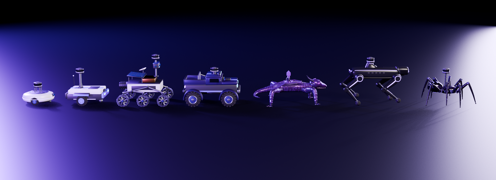
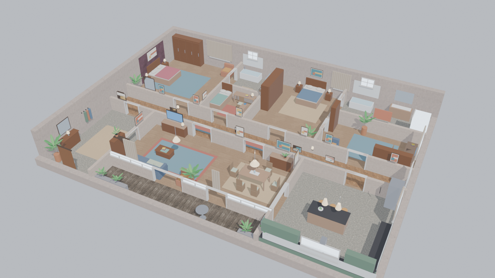
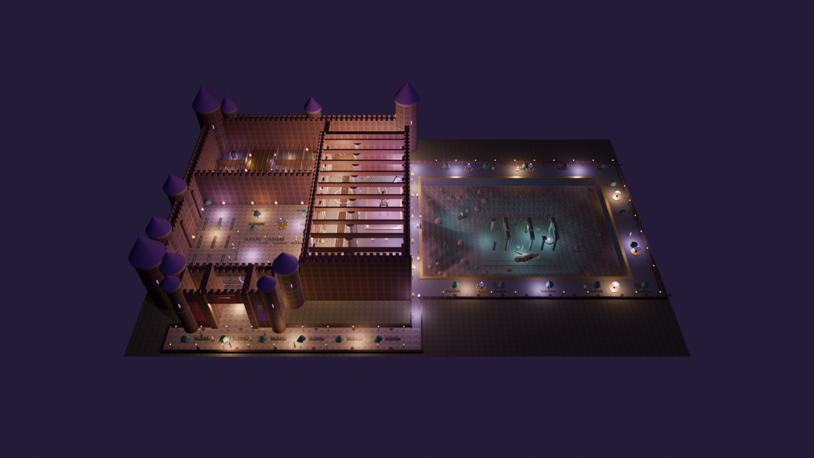
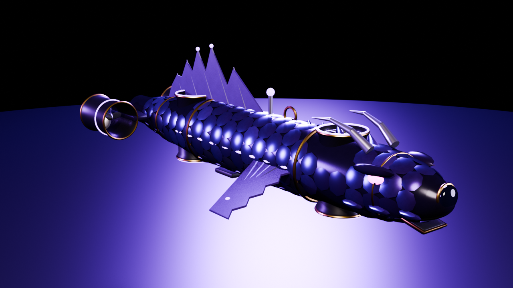
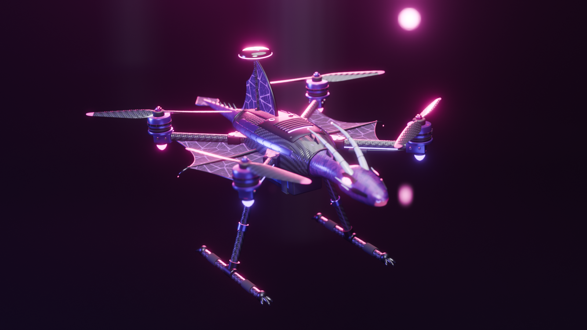
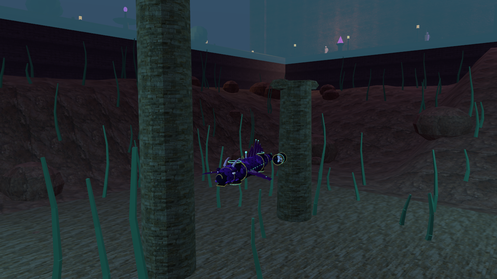
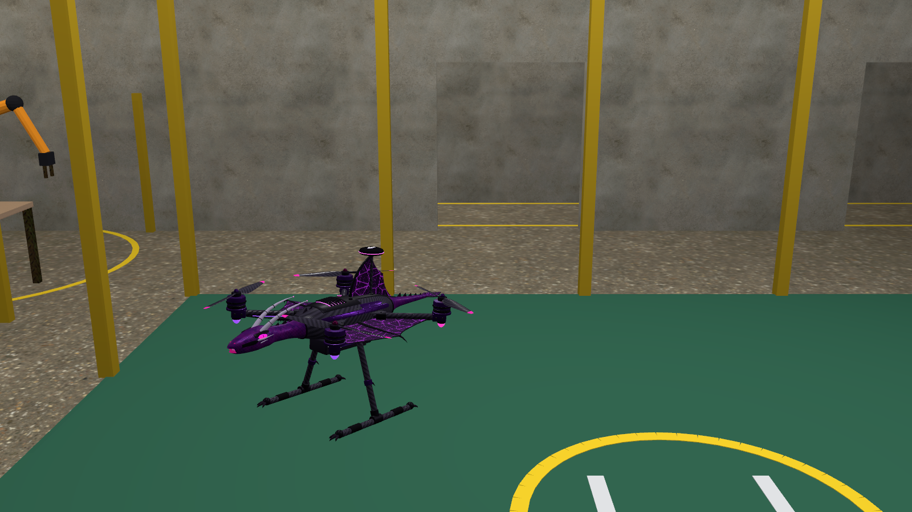
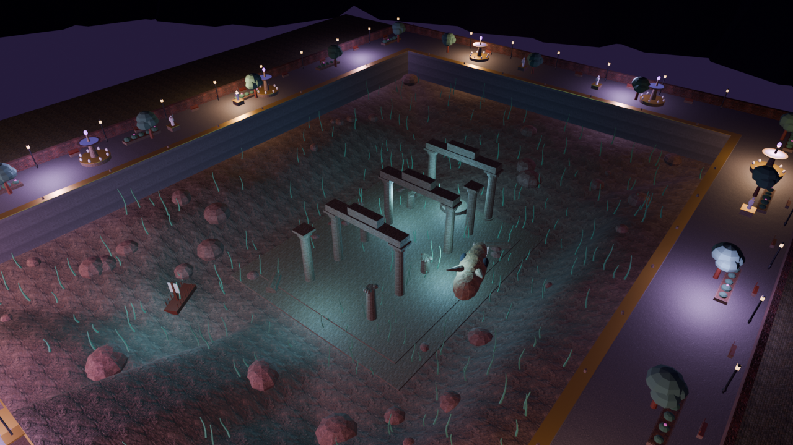
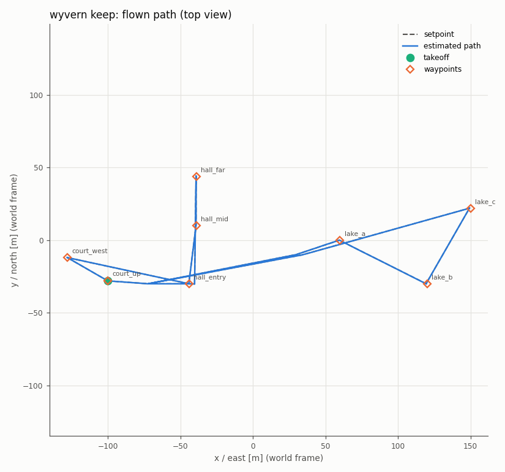

# robot-fleet-sim

A ROS 2 Jazzy / Gazebo Harmonic workspace that simulates custom robots in custom worlds. Robots and worlds
are modelled with headless Blender Python scripts and exported to meshes and SDF that are committed, so the
ROS side builds without Blender. Parts (sensors, motors, batteries, propellers, thrusters) come from a
catalog of real products with datasheet numbers, and the simulated sensors reproduce the ROS 2 interface of
the real drivers.

The realism pass is not finished. Read the [Realism status](#realism-status) table before you trust a number.

| kind | robots | launch |
|---|---|---|
| wheeled | `round`, `box`, `rover` (rocker-bogie), `truck` | `fleet_bringup sim.launch.py` |
| legged | `wyrm` (hexapod), `hound` (quadruped), `spider` (octopod) | `fleet_bringup sim.launch.py` |
| underwater | `knucker` AUV (4 Blue Robotics T200 thrusters, DVL, AHRS) | `fleet_auv auv.launch.py` |
| multicopter | `wyvern` quadrotor on PX4 SITL | `fleet_drone drone.launch.py` |

Worlds: `apartment`, `lab`, `warehouse`, `keep` (a castle with a lake; the AUV and the drone use it too),
plus a 20 m test tank for the AUV.

## Gallery

Previews rendered by Blender (`blender/previews/`) and Gazebo captures (`docs/img/`).

| | | |
|---|---|---|
|  |  |  |
| the seven ground robots | apartment world | keep world |
|  |  |  |
| knucker AUV | wyvern quadrotor | AUV in the keep lake (Gazebo) |
|  |  |  |
| wyvern in the lab (Gazebo) | keep lake (Blender) | wyvern keep mission track |

## Requirements

- Ubuntu 24.04 or a derivative (Pop!_OS 24.04 tested) for a native install; any other system (other Linux, macOS,
  Windows with WSL 2) through the [container](docker/README.md).
- ROS 2 Jazzy, Gazebo Harmonic (gz-sim 8), Nav2, `gz_ros2_control`, `robot_localization`, `slam_toolbox`,
  `marine_acoustic_msgs` and the Gazebo Python bindings. `./setup.sh` installs all of them.
- Any x86 machine with an OpenGL-capable GPU or iGPU; developed on an 8-thread i5-10210U laptop with an Intel
  iGPU and 15 GB RAM. Simulations run headless (`gui:=false`); the real-time factor drops to 0.4-1.0 with sensors on.
- Optional: PX4-Autopilot built for `px4_sitl_default` (wyvern drone only; `./setup.sh --px4` builds it) and
  Blender 5.x (only to rebuild models).

## Install

```bash
git clone https://github.com/AJC-006/robot-fleet-sim.git
cd robot-fleet-sim             # the colcon workspace root; every command below runs from here
./setup.sh                     # add --px4 for the drone's PX4 SITL; --help lists the options
source install/setup.bash
```

`setup.sh` does each step only if its result is missing, so it is safe to re-run (after a `git pull`, say):

1. checks for Ubuntu 24.04 (noble); on anything else it points you to the [container](docker/README.md);
2. adds the ROS 2 and Gazebo (packages.osrfoundation.org) apt sources and installs ROS 2 Jazzy if `/opt/ros/jazzy`
   is missing;
3. installs the project's apt packages ([scripts/install_deps.sh](scripts/install_deps.sh)) and the remaining
   `package.xml` keys with rosdep;
4. builds the Micro-XRCE-DDS agent for the drone into `.deps/` without sudo
   ([scripts/install_xrce_agent.sh](scripts/install_xrce_agent.sh); skip with `--no-drone`);
5. with `--px4`, clones PX4-Autopilot into `$PX4_DIR` (default `~/PX4-Autopilot`), checks out the pinned commit
   and builds `px4_sitl_default`;
6. runs `colcon build --symlink-install` (skip with `--no-build`).

**Existing installations.** `setup.sh` installs only what is missing and leaves the rest alone, with three
safeguards:

- whenever apt installs something, it first upgrades the ROS 2 Jazzy and Gazebo packages already installed, because
  ROS packages do not pin each other's versions and mixing an old installation with new packages can fail at run
  time with undefined symbols. If nothing needs installing but updates are available, it says so;
  `./setup.sh --upgrade` installs them;
- it ignores any other ROS distribution or workspace sourced in your shell (from `~/.bashrc`, say) and builds
  against `/opt/ros/jazzy` only. Do the same when you run the simulation: a fresh terminal with only
  `source install/setup.bash`;
- a newer Gazebo (Ionic, Jetty) installed next to Harmonic is fine: every launch starts Gazebo with
  `--force-version 8`, the version the plugins are built against.

It asks for your sudo password once, and only when an apt step is needed. It never stops at the first problem: it
runs every step it can, ends with a list of what failed and writes everything to `setup.log`.

**Other systems.** ROS 2 Jazzy ships binaries for Ubuntu 24.04 only. Elsewhere, with Docker installed:

```bash
docker/run.sh ./setup.sh       # builds the image once, then the workspace inside it
docker/run.sh                  # a shell with everything sourced
```

Details, graphics and caveats: [docker/README.md](docker/README.md).

**PX4 by hand.** The wyvern needs PX4-Autopilot built for SITL; the simulation only reads the checkout.
`src/px4_msgs` was generated from PX4 `main` at commit `e146fe4cc6` (2026-10-14, after v1.18.0-beta1), so use that
commit; another PX4 version needs `px4_msgs` regenerated from its `msg/` directory. `./setup.sh --px4` does the
following, which you can also run yourself:

```bash
git clone https://github.com/PX4/PX4-Autopilot.git ~/PX4-Autopilot
cd ~/PX4-Autopilot
git checkout e146fe4cc69459493196b172d9b4576dc4bce127 && git submodule update --init --recursive
bash Tools/setup/ubuntu.sh --no-nuttx      # PX4's own dependency script (asks for sudo)
make px4_sitl_default
cd -
```

`~/PX4-Autopilot` is the default location; for another one pass `px4_dir:=...` or set `PX4_DIR`. Details:
[the aircraft guide](docs/guides/aircraft.md) and [docs/notes/drone.md](docs/notes/drone.md).

## Build

`./setup.sh` builds the workspace. After you change code, rebuild with:

```bash
source /opt/ros/jazzy/setup.bash
colcon build --symlink-install
source install/setup.bash
```

## Quickstart

The AUV and drone launches are headless by default. The wheeled and legged launch defaults to the Gazebo GUI and
RViz, so pass `gui:=false rviz:=false` on a machine without a display. Set `ROS_DOMAIN_ID` and `GZ_PARTITION`
if other ROS or Gazebo users share the network.

```bash
# wheeled or legged robot with Nav2 (AMCL on the world map); ready when Nav2 reports "Managed nodes are active"
ros2 launch fleet_bringup sim.launch.py robot:=round world:=apartment gui:=false rviz:=false
ros2 launch fleet_bringup sim.launch.py robot:=hound world:=lab spawn:=workshop gui:=false rviz:=false
ros2 launch fleet_bringup sim.launch.py robot:=rover world:=warehouse slam:=true gui:=false rviz:=false

# send a goal (map frame) once Nav2 is up
ros2 action send_goal /navigate_to_pose nav2_msgs/action/NavigateToPose \
  "{pose: {header: {frame_id: map}, pose: {position: {x: 2.0, y: 1.0}, orientation: {w: 1.0}}}}"

# AUV: tank or lake, with sensor drivers and the EKF (odom -> base_link); thrusters take PWM in microseconds
ros2 launch fleet_auv auv.launch.py world:=tank namespace:=knucker
ros2 topic pub --once /knucker/thrusters/vfore/pwm_us std_msgs/msg/Float64 "{data: 1550.0}"

# multicopter: PX4 SITL + uXRCE-DDS agent + the world's waypoint mission
ros2 launch fleet_drone drone.launch.py world:=lab mission:=true
ros2 launch fleet_drone drone.launch.py world:=keep mode:=hover hover_alt:=3.0
```

Every argument of each launch file, with its description: `ros2 launch <pkg> <file> --show-args`. The table is in
[docs/configuration.md](docs/configuration.md#launch-arguments). `use_sim_time` is always true (not an argument).
Only the AUV launch has a `namespace` argument so far (G7 adds it to the wheeled/legged launch).

## Components and swapping parts

Each part is one YAML file in `src/fleet_components/components/<category>/<vendor>_<model>.yaml`: datasheet
and source URLs, specs in SI, the real ROS 2 driver it reproduces (package, topics, frame_id, rate, QoS), the
mapping from specs to simulation parameters, and what the simulation does not reproduce. Robots pick parts by
file stem. To swap a lidar, change one line in `src/fleet_description/config/robots.yaml`:

```yaml
round:
  components:
    lidar: slamtec_rplidar_s2      # was slamtec_rplidar_c1
```

then `colcon build --packages-select fleet_description` and relaunch. Mass, centre of mass and inertia are
regenerated by `python3 tools/mass_properties.py` (writes `config/mass_properties.yaml`). The catalog schema and
rules: [src/fleet_components/components/README.md](src/fleet_components/components/README.md).

Catalog today: lidar (Slamtec RPLIDAR C1, S2), IMU/AHRS (MicroStrain 3DM-CV7-AHRS), depth camera (Intel
RealSense D435), DC motors (Pololu 37D 50:1 and 70:1 with 64 CPR encoder), motor driver (Basicmicro RoboClaw
2x15A), servos (Robotis XM430-W210, XH540-W150), batteries (Samsung INR18650-35E, Blue Robotics 4S 18 Ah),
tyre material pair, thruster and ESC (Blue Robotics T200, Basic ESC), DVL (Water Linked A50), pressure (Bar30),
flight-controller sensors (TDK ICM-42688-P, Bosch BMI055, TE MS5611, Isentek IST8310, u-blox MAX-M10S),
brushless motor, propeller and ESC (T-Motor AIR2216II KV920, T1045, Air 20A).

## Worlds and named spawns

Worlds live in `src/fleet_worlds/worlds/<name>.sdf` with a sidecar `<name>.yaml` holding `spawn`, named
`spawns`, Nav2 `goals`, the occupancy map (`maps/<name>.yaml`) and the drone mission. Start at a named pose with
`spawn:=<name>` (lab: `arena`, `workshop`, `cage_centre`, `server_room`, ...), or override with `x:= y:= yaw:=`.
Worlds are generated by `blender/build_worlds.py`; `tools/check_world.py` verifies that the spawn reaches the
goals on the occupancy map. Pattern for a new world: [docs/configuration.md](docs/configuration.md#worlds).

## Tests

```bash
scripts/run_all_tests.sh --list          # test names
scripts/run_all_tests.sh --quick         # colcon test, world checks, one headless launch to "ready" per kind
scripts/run_all_tests.sh --full          # quick plus Nav2 2-goal runs, AUV lake mission, wyvern missions
scripts/run_all_tests.sh --only nav2_    # a subset (rows of earlier runs are kept)
```

The exit code is non-zero if a test FAILs; XFAIL marks a documented known failure. Results are written to
[docs/notes/test_results.md](docs/notes/test_results.md). Latest (2026-10-25): **17 PASS, 1 XFAIL**.

| set | result | duration measured on the 8-thread laptop |
|---|---|---|
| `colcon test` (88 tests) | pass | 34 s |
| world checks (4 worlds) | pass | 0-1 s each |
| ready state, one launch per kind (wheeled, legged, AUV, wyvern) | pass | 13-25 s each |
| Nav2 two-goal runs (box, wyrm, truck, hound, rover, spider, round) | pass | 2-4 min each (about 21 min together) |
| wyvern lab mission | pass | 1.8 min |
| AUV keep-lake mission | XFAIL (controller unstable, see below) | 22 min |

`--quick` is the 9 rows above the Nav2 runs (about 2 min of measured test time on a built workspace). The
complete `--full` (every ground robot in every world, plus SLAM and lidar checks) was not timed as a whole; the
measured rows above add up to about 46 min, and the script header estimates 3-4 hours for the full matrix.

## Realism status

The rule of this repository: every number comes from a cited source or a derivation written next to it, sensors
are real products with real-driver outputs, and where Gazebo cannot model an effect a plugin does. This table
says where that is true and where it is not yet. Specs of the deferred work (G4-G7, S3, A2-A6) are in
[docs/notes/ground.md](docs/notes/ground.md), [docs/notes/sea.md](docs/notes/sea.md) and
[docs/notes/air.md](docs/notes/air.md).

| robot / subsystem | modelled from real components and validated | pending |
|---|---|---|
| Physics engine, all worlds | DART with dantzig solver (selected by the Physics system `<engine>` element, not the ignored `type` attribute); floor friction pairs cited; `CoulombFriction` plugin gives a friction cone; yaw bench in `docs/notes/ground_bench` (G2) | bullet-featherstone turning failure never root-caused |
| Ground sensors (all 7 ground robots) | RPLIDAR C1/S2 binning as in `sllidar_ros2`, CV7-AHRS `imu/data_raw` + `imu/data`, D435 topics (`fleet_sensor_sim`; its 8 pytest tests) | lidar intensity not published; camera runs below 30 Hz on the iGPU |
| Ground mass and inertia | parallel-axis budget from part statistics, `tools/mass_properties.py`; 31 tests in `fleet_description` | legged structure mass comes from parameters, not the mesh |
| Wheeled drive: round, box | geometric wheel separation (multiplier 1.0), yaw ratio 1.01 measured (G2 bench); Nav2 two-goal tests pass | motors and driver are still ideal velocity interfaces: **G4 (DC motor, RoboClaw, encoder plugin) not done** |
| Rover, truck (skid steer) | tyre friction from the catalog; Nav2 two-goal tests pass | **still use a measured track factor** (`wheel_separation_multiplier` 1.234 and 1.886); G5 replaces it with a model |
| Legged: wyrm, hound, spider | kinematics and gait; Nav2 two-goal tests pass | **actuator limits do not match real Dynamixel servos**: leg demand at the real masses exceeds every single X-series servo (G3 table); `odom_scale` and the 16-25 rad/s joint limits remain. G6 retargets the legs |
| Nav2 / EKF (ground) | run in all four worlds | parameters not yet derived from sensor specs; no `namespace` argument (G7) |
| AUV knucker: model | S1 derivations (inertia, added mass, damping, buoyancy), `<fluid_added_mass>`, trim test `settle_check` (pitch -0.27 deg, limit 0.4), pytest model checks | OCV(SoC), DVL and CV7 numbers partly unpublished (flagged in the entries) |
| AUV: thrusters, battery, sensors | `T200Thruster` (vendor table, PWM and bus voltage, deadband, dynamics), `LiIonBattery`, DVL A50, CV7 and Bar30 emulators; ctest 4/4 | **T200 thrust at speed is a bollard upper bound** (no KT(J)), so surge speeds are optimistic |
| AUV: control | plant at rest is stable | **the depth/heading controller is unstable on the realistic model; the keep-lake mission is XFAIL.** Retune is S3. The `docs/img/auv_*.png` plots predate the realistic model and are stale |
| Wyvern quadrotor | sensors from the catalog (ICM-42688-P, MS5611, IST8310, MAX-M10S), `GnssError` plugin, T-Motor AIR2216II + T1045 thrust fit; `test_air_catalog.py`; lab mission passes | base mass, inertia and rotor drag coefficients are still x500 values; no vibration or battery sag |
| VTOL, flapping wing | not started | A2-A6 |

## Regenerating assets with Blender

Exports are committed; Blender 5.x is needed only to change a model.

```bash
blender -b --factory-startup -P blender/build_robots.py -- --robot round      # all seven without --robot
blender -b --factory-startup -P blender/build_worlds.py -- --world lab        # --no-preview skips the render
blender -b --factory-startup -P blender/auv/build_auv.py -- --no-render       # knucker
blender -b --factory-startup -P blender/drone/build_drone.py                  # wyvern meshes
python3 blender/drone/make_sdf.py                                             # wyvern SDF from the catalog
python3 tools/mass_properties.py                                              # config/mass_properties.yaml
```

Rebuild the touched packages afterwards, for example
`colcon build --symlink-install --packages-select fleet_description fleet_worlds`.

## Repository layout

```
src/fleet_bringup         sim.launch.py (wheeled + legged), Nav2/EKF/bridge configs, RViz, patrol test node
src/fleet_description     robots.yaml, mass_properties.yaml, xacro, robot meshes
src/fleet_components      component catalog (YAML) + xacro macros that read it
src/fleet_sensor_sim      real-driver emulators for lidar, IMU, camera
src/fleet_gz_plugins      CoulombFriction world plugin
src/fleet_legged          legged kinematics, gait, odometry
src/fleet_auv             knucker model generator, launch, EKF, controller, tests
src/fleet_marine_plugins  T200Thruster and LiIonBattery plugins
src/fleet_aircraft        GnssError plugin
src/fleet_drone           wyvern launch, PX4 glue, mission
src/fleet_worlds          world SDF + yaml, occupancy maps, models
src/px4_msgs              PX4 message definitions
blender/                  Blender generators, .blend sources, previews
tools/                    derivations and checks (mass, motor fit, world check, leg demand)
scripts/                  install and test scripts
docs/                     configuration.md, ARCHITECTURE.md, guides/, notes/ (per-lane notes and results)
docker/                   container for systems other than Ubuntu 24.04 (Dockerfile, run.sh)
setup.sh                  one-step install and build
```

## Documentation

- [docs/configuration.md](docs/configuration.md): robot config, mass properties, catalog schema, worlds, launch
  arguments, parameter files, where each number comes from.
- Guides: [add a robot](docs/guides/add_a_robot.md), [swap a sensor or any part](docs/guides/swap_a_sensor.md),
  [add a world](docs/guides/add_a_world.md), [the underwater robot](docs/guides/auv.md),
  [the aircraft and how to add a PX4 airframe](docs/guides/aircraft.md).
- [docs/ARCHITECTURE.md](docs/ARCHITECTURE.md): robot kinds, data flow, packages, frame tree, physics settings,
  where the tests live.
- [docs/notes/](docs/notes/README.md): design notes per area (derivations, audits, measurements, test results).
- [ROADMAP.md](ROADMAP.md): known gaps and planned work. [CONTRIBUTING.md](CONTRIBUTING.md): how to change things.

## Licence and credits

[Apache License 2.0](LICENSE): you may use, change and redistribute the project, commercially too, as long as you keep
the licence and copyright notices and mark changed files. Parts with their own licence:

- `src/px4_msgs`: BSD 3-Clause, generated from PX4-Autopilot (`src/px4_msgs/LICENSE`).
- `src/fleet_drone/models/wyvern/model.sdf`: derived from PX4's x500 model, BSD 3-Clause
  (`src/fleet_drone/models/wyvern/LICENSE`).
- Third-party textures and assets: CC0 or permissive, listed in `src/fleet_description/CREDITS.md`,
  `src/fleet_worlds/CREDITS.md` and `src/fleet_drone/CREDITS.md`.

Component numbers are facts from the vendors' public datasheets, with the URLs in each catalog entry. Product names
belong to their owners and imply no endorsement.
